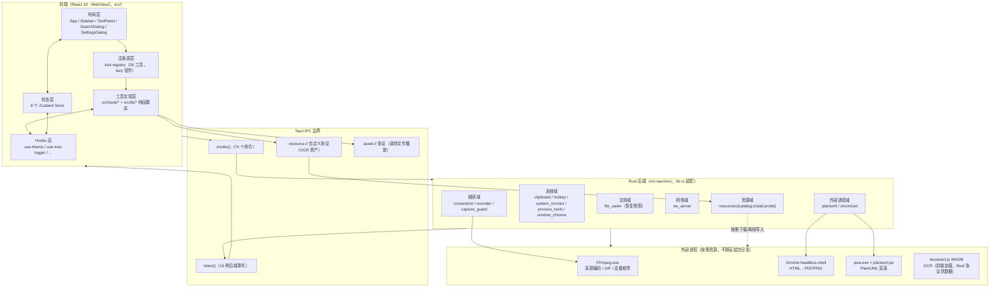
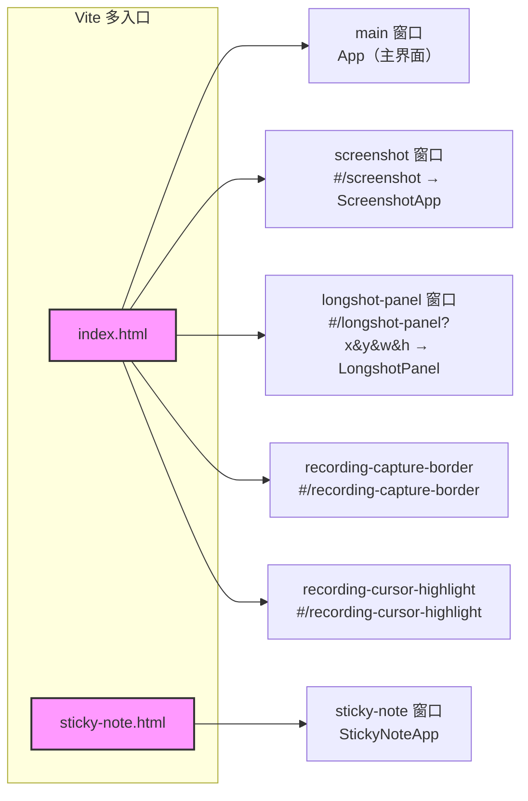
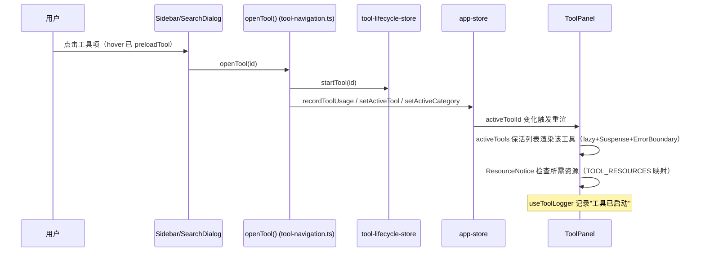
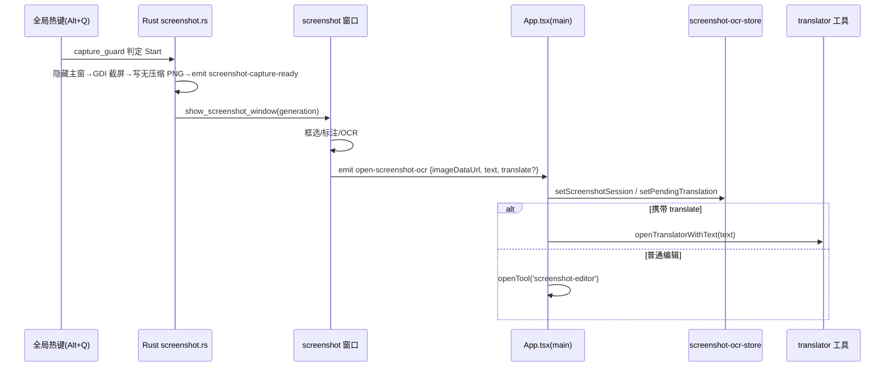
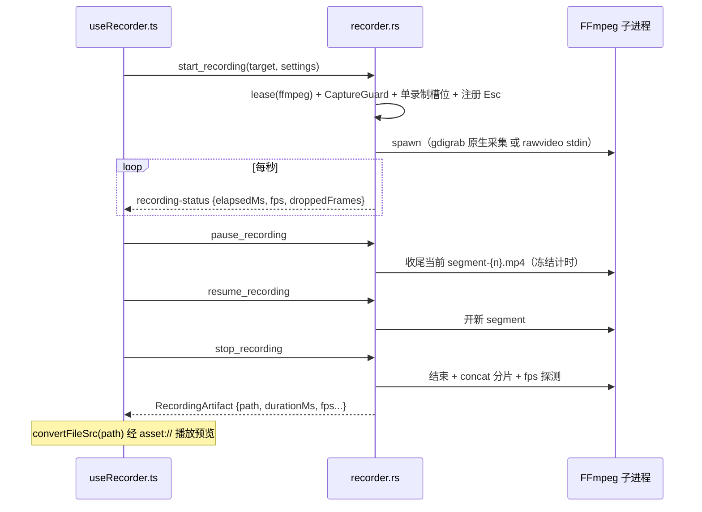
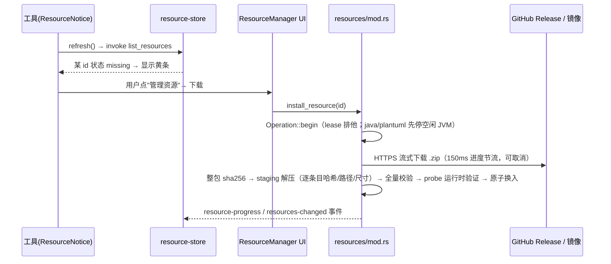

# 02 · 整体架构

## 1. 分层架构总览

**职责边界**：
- **前端**承担全部 UI、工具的纯计算（转换/编解码/格式化/图像处理/PDF 结构操作等大量工作在 JS 完成）。
- **Rust**承担一切需要操作系统权限或子进程的能力：屏幕捕获、录屏编码、剪贴板、全局快捷键、系统监控、进程管理、文件对话框、外部进程编排（FFmpeg/Chromium/Java）。
- **网络请求**双态：Tauri 下用 `@tauri-apps/plugin-http` 的 fetch（绕 CORS），浏览器回退 `window.fetch`（`src/lib/api-client.ts` 的 `isTauri` 判定）。

## 2. 多窗口架构

tauri.conf.json 只静态声明 `main` 一个窗口，其余 5 个窗口全部由 Rust 动态创建；前端只有 2 个物理 HTML 入口，靠 **hash 路由**复用同一份 `src/main.tsx`。

| 窗口 label | 创建时机 | 角色 | 关键特性 |
| --- | --- | --- | --- |
| `main` | 静态配置 | 主界面 | 1280×800 无边框；关闭被拦截（退出/托盘二选一，运行期记忆）；单实例插件二次启动聚焦 |
| `screenshot` | setup 阶段预热（隐藏） | 全屏透明截图/框选/标注层 | 跨会话复用（close 仅 hide+复位，Destroyed 才释放会话）；show 时全屏置顶 |
| `longshot-panel` | 每次长截图会话新建 | 长截图"呼吸边框"控制条 | 外环 3px、光标穿透、不抢焦点；Destroyed 注销临时 Esc + 恢复光标 |
| `recording-capture-border` | 录屏时预热/复用 | 录制范围红色边框 | 100ms 跟随线程（窗口模式跟随目标移动） |
| `recording-cursor-highlight` | 同上（Windows） | 32×32 光标高亮窗 | 16ms `GetCursorPos` 跟随 |
| `sticky-note` | 快捷键/工具页按需创建 | 悬浮便签 | 独立 HTML；无边框不透明；贴边隐藏/露出动画；CloseRequested 转为 hide |

## 3. 核心设计决策

### 3.1 工具注册制（声明式，无路由）

项目**没有使用 React Router 路由表**（依赖虽存在但未被引用）。工具导航完全由 Zustand 状态（`activeToolId`）驱动；窗口级"路由"由 `main.tsx` 的 hash 分派完成。新工具只需在 [tool-registry.ts](../../src/registry/tool-registry.ts) 调用 `registerTool({...})`，即自动接入搜索（含拼音）、侧栏、快捷栏、生命周期管理。

### 3.2 工具生命周期 + keep-alive 保活

仿 uTools 插件模型：
- 工具组件 `React.lazy` 懒加载，侧栏 hover 时 `preloadTool()` 预取代码；
- `tool-lifecycle-store` 维护 `activeTools`（运行中列表）与 `alwaysOnTools`（常驻列表）；
- ToolPanel 对**所有运行中工具同时挂载**，非当前工具仅 `hidden` 隐藏 —— 切换工具不卸载组件，表单/画布状态天然保留。

### 3.3 捕获并发安全（三层防护）

1. **快捷键决策层**：`capture_guard::decide_shortcut()` 纯函数 —— 已有捕获会话时忽略其他工具快捷键，仅录屏键可停止当前录制；
2. **共享锁层**：`CaptureGuardState` 串行化截图/长截图/录屏"检查并启动"的临界区；
3. **会话层**：各会话自带 generation / slot / finishing 原子位防重入与并发收尾（见 05 章各模块）。

### 3.4 资源按需化（小安装包策略）

Chromium/FFmpeg/Java/PlantUML/OCR 二进制不随安装包分发（NSIS 包仅含许可证文件），运行时由 4 级解析（用户自选 → 已校验托管包 → 开发捆绑 → 系统程序）+ 下载/离线导入 + 逐文件 SHA-256 + 运行时 probe 提供。详见 [08-资源按需管理系统](08-资源按需管理系统.md)。

### 3.5 预热（Warm-up）文化

setup 空闲阶段后台预热：FFmpeg 编码器探测（`-encoders`）、截图窗口预建、录制边框/光标覆盖窗预建、PlantUML JVM 预 spawn —— 热路径（快捷键触发）只做复用，无建窗/探测延迟。

## 4. 关键数据流

### 4.1 打开一个工具

### 4.2 全局快捷键截图 → OCR → 翻译

### 4.3 录制会话（暂停/恢复分片）

### 4.4 按需资源下载

## 5. 应用启动流程

### 5.1 前端（main.tsx）

1. 依次导入字体、`index.css`、`i18n`（副作用初始化）、`store/log-store`（副作用：注入日志 sink）；
2. 性能埋点 `markPerformance('app:main-start')`；
3. 按 hash/pathname 分派 6 种窗口 UI（截图/长截图面板/录制边框/光标高亮/便签/主应用），透明窗口强制透明背景；
4. 注册全局 `error` / `unhandledrejection` 捕获 → `appLogger.error`；
5. `createRoot(#root).render(<StrictMode>…)`。

### 5.2 主窗口（App.tsx 挂载）

- `useApplyTheme()` 写主题（CSS 变量 + `set_window_chrome` IPC）；
- effect：`measurePerformance`（首屏）+ `initAlwaysOnTools()`（拉起常驻工具）；
- Tauri 环境下监听 `open-screen-recorder` / `open-longshot-editor` / `open-screenshot-ocr` 三个后端事件；
- 渲染布局：`AtmosphereLayer（指针特效） + Sidebar + ToolPanel + StatusBar + SearchDialog + SettingsDialog + Toaster + NativeFileDropBridge`。

### 5.3 Rust（lib.rs `run()` setup 阶段）

1. `dev_server::ensure`（仅 debug+Windows：独立启动时自动拉起 Vite）；
2. `recorder::cleanup_stale_recordings`（清 24h 前缓存）；
3. `warm_up_recording_encoder` / `warm_up_recording_overlay_windows`（后台预热）；
4. `clipboard::init_clipboard_history` → `record_startup_clipboard_image` → `start_clipboard_monitor`（800ms 轮询线程）；
5. `hotkey::load_hotkey_bindings` → `register_all`（5 个全局动作）；
6. `screenshot::load_screenshot_settings` → `ensure_screenshot_window`（预建截图窗）；
7. 后台线程 `plantuml::warm_up`（预 spawn JVM）；
8. 托盘创建（自启动/重启/退出菜单 + 双击显示主窗）。

## 6. 持久化拓扑

| 数据 | 位置 | 说明 |
| --- | --- | --- |
| 外观（主题/皮肤/氛围/指针特效/吉祥物）、侧栏折叠、快捷固定栏 | localStorage `niuery-toolkit-store`（v7，partialize + 归一化 merge） | app-store |
| 常驻工具列表 | localStorage `niuery-toolkit-lifecycle` | tool-lifecycle-store |
| API 调试集合/环境/历史/Mock | localStorage `niuery-api-tester` | api-tester-store |
| 百度翻译凭据 | localStorage `niuery-translate-store` | translate-store |
| 界面语言 | localStorage `niuery-toolkit-lang` | i18next |
| Markdown 草稿 | localStorage `niuery-markdown-editor-draft`（1s debounce） | markdown-editor |
| 工具编辑态（输入/输出） | **内存 Map**（tool-state-store，不持久化） | 切换保留 |
| 运行中工具、最近使用、日志、OCR 会话 | **内存**（不持久化） | — |
| 快捷键绑定、截图设置、便签文档、剪贴板历史 | 应用 config 目录 JSON（Rust 侧读写） | hotkeys.json / screenshot.json / sticky-note.json / clipboard_history.json |
| 崩溃恢复快照 | `$APPDATA/document-recovery/{tool}-{id}.json` | mind-map / excalidraw / tldraw |
| 按需资源 | `$APPDATA/resources-v1/<id>/<version>/` | 详见 08 章 |
