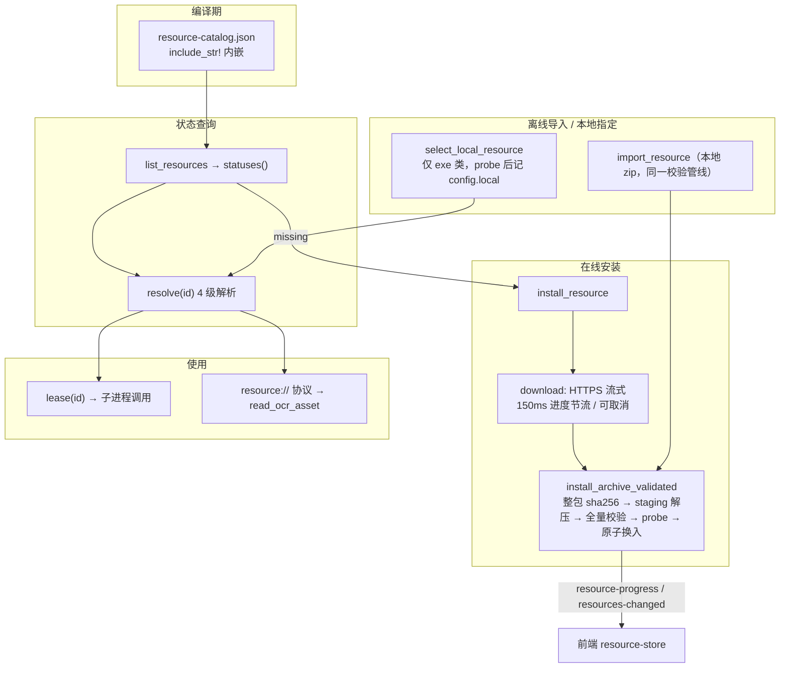

# 08 · 资源按需管理系统

> 目标：**小安装包**。Chromium（119.5MB 下载）、FFmpeg（56.4MB）、Java（37.5MB）、PlantUML（28MB）、OCR 引擎与中英模型（2.6/20/10.9MB）不随 NSIS 安装包分发，首次使用对应功能时提示下载/离线导入/复用本机程序，之后全程离线可用。
> ADR：[docs/adr/2026-10-16-on-demand-resources.md](../adr/2026-10-16-on-demand-resources.md)。

## 1. 资源目录（7 个包）

定义于 [src-tauri/resource-catalog.json](../../src-tauri/resource-catalog.json)，由维护者执行 `npm run resources:pack` 生成（[scripts/resource-packages.mjs](../../scripts/resource-packages.mjs)），**编译期 `include_str!` 内嵌进二进制**（`catalog.rs` 的 OnceLock 单例）—— 这是唯一的信任根（"No remote manifest replaces the trust root"）。

| id | version | platform | entry | 下载/安装体积 |
| --- | --- | --- | --- | --- |
| chromium | 1234 | windows-x86_64 | chrome-headless-shell.exe | 119.5MB / 283.9MB |
| ffmpeg | 20260802 | windows-x86_64 | ffmpeg.exe | 56.4MB / 134.3MB |
| java | 17.0.20 | windows-x86_64 | bin/java.exe | 37.5MB / 107.7MB |
| plantuml | 1.2026.6 | any | plantuml.jar | 28.0MB / 29.5MB |
| ocr-engine | 7.0.0 | any | worker.min.js | 2.56MB / 6.89MB |
| ocr-chi-sim | 1 | any | chi_sim.traineddata.gz | 20.1MB / 20.2MB |
| ocr-eng | 1 | any | eng.traineddata.gz | 10.9MB / 10.9MB |

每个资源含**包级** sha256/downloadBytes/installedBytes + **全量 files 逐文件** bytes/sha256。默认下载源 `releaseBase = https://github.com/PeterPandefu/Niuery-Toolkit/releases/download/resources-v1`（GitHub 固定 tag Release）。

## 2. 资源生命周期全景

## 3. 四级解析优先级（[resources/mod.rs](../../src-tauri/src/resources/mod.rs) `resolve()`）

1. **local**：用户自选程序（`config.json` 的 `local` 映射；仅 ffmpeg/chromium/java 可自选）；
2. **managed**：应用托管的按需安装包 —— 先 `install::verify_directory` **全量哈希校验**再 `probe::validate`；
3. **bundled**（legacy）：开发用捆绑资源（`src-tauri/resources/`，debug 下含 `src-tauri/resources` 双路径）；
4. **system**：本机程序（`probe::system_candidates`：环境变量 `NIUERY_FFMPEG_PATH/NIUERY_CHROMIUM_PATH/NIUERY_JAVA_PATH` → `JAVA_HOME/bin/java.exe` → PROGRAMFILES 下的 Edge/Chrome → PATH 查找）。

失败错误格式：`"RESOURCE_REQUIRED:{id}: Open Settings → Resources to download or select a local resource"`（前端据此引导）。probe 结果按 `(id, path, len, mtime)` 缓存。

安装根：`$APPDATA/resources-v1/<id>/<version>/`；配置：`resources-v1/config.json`（local 映射 + mirror 镜像；`CONFIG_LOCK` 串行；临时文件 + `.previous` 备份 + rename 原子写 + 失败回滚）。

## 4. 租约与操作互斥（与渲染/录屏联动）

- `operations()`：静态 `HashMap<String, (usize /*lease 计数*/, Option<Arc<AtomicBool>> /*cancel*/)>`；
- `lease(id) -> ResourceLease`：**渲染/录制前取得**，Drop 减计数；存在进行中的 Operation 则报错 "Resource is being changed; please retry"；
- `Operation::begin(id)`：要求 lease 计数为 0 且无 Operation；**id 为 java/plantuml 时先 `plantuml::stop_idle_workers()`**（空闲 JVM 不持有租约；活动渲染已持 lease 排他）；Drop 清 cancel 旗标。

效果：运行中的录屏/渲染会**阻止资源替换**；校验失败或中断**不会激活半成品**，已有版本保留。

## 5. 安装管线（[resources/install.rs](../../src-tauri/src/resources/install.rs)）

`install_archive_validated(archive, destination, resource, cancel, validate)`：

1. 压缩包整体 sha256 + size == 目录声明；
2. stage 目录 `.stage-{nanoid}` 解压：逐条目 `safe_relative`（拒绝空段/`\`/`:`/`\0`/前导 `/`/`.`/`..`/尾点尾空格/控制字符/**Windows 保留名** CON/PRN/AUX/NUL/COM1-9/LPT1-9）、名称去重（大小写不敏感）、拒绝目录与 symlink（unix_mode `0o120000`）、必须命中目录清单且解压尺寸一致、`take(expected.bytes+1)` 防写超；
3. `verify_directory(stage)`：`reject_links`（**连祖先目录一起检查 reparse point 0x400 与 symlink**，防 junction 重定向）→ 遍历目录**白名单外文件即报错**（防 DLL 注入）→ 逐文件 bytes+sha256 校验；
4. `validate(entry)`：运行时兼容性 probe（见 §6）；
5. **原子换入**：旧目录 → `.previous-{nanoid}` 备份 → stage → destination（失败回滚），成功删备份；stage 残留清理。

## 6. 运行时探测（[resources/probe.rs](../../src-tauri/src/resources/probe.rs)）

`validate(id, path)` —— 资源**运行时**可用性检查：

| 资源 | 探测方式 |
| --- | --- |
| ffmpeg | `-encoders` 需含 libx264\|libopenh264\|h264_mf 之一 + aac + gif；`-filters` 需含 palettegen/paletteuse/scale/fps/amix/split；`-formats` 需含 gdigrab/dshow/rawvideo/concat/mp4/gif |
| java | `-version` 解析主版本 ≥ 17 |
| chromium | 写 probe.html → headless 同时 `--print-to-pdf` 与 `--screenshot` → 校验 `%PDF` 与 `\x89PNG` 魔数 |
| plantuml / ocr-* | 无运行时校验（jar/数据文件由哈希保证） |

`command_output`：临时目录重定向 stdout/stderr（规避管道死锁）、CREATE_NO_WINDOW、15s 超时或输出 >2MB 即 kill。

## 7. OCR 资产分发（resource:// 协议）

- lib.rs 注册 `register_asynchronous_uri_scheme_protocol("resource", ...)`；
- 前端 [resources.ts](../../src/lib/resources.ts) 的 `ocrAssetUrls(language)`：Tauri 用 `convertFileSrc('', 'resource')` 构造目录型虚拟 URL（浏览器回退 `public/ocr/`）；
- `read_ocr_asset(app, path)`：`ocr_request` **白名单映射**（`/lang/eng.traineddata.gz → ocr-eng`、`/lang/chi_sim.traineddata.gz → ocr-chi-sim`、`/ocr-engine/... → ocr-engine`，并校验文件在目录中）→ lease → resolve → 读文件 → **逐文件 bytes+SHA-256 校验** → mime（.js/.wasm/其余）→ 附加 `Access-Control-Allow-Origin: *` + `nosniff`。

## 8. 命令与事件

命令（9）：`list_resources` / `install_resource` / `cancel_resource_download` / `remove_resource`（canonicalize 双重校验目标在 root 内且非 root 本身 → remove_dir_all）/ `select_local_resource` / `import_resource` / `set_resource_mirror`（非空必须 HTTPS、无凭据/查询/片段）/ `get_resource_mirror` / `get_resource_paths`。

事件：`resource-progress {id, phase: downloading|verifying, received, total}`（下载 150ms 节流）、`resource-operation-ended {id}`、`resources-changed`。

下载细节：reqwest **https_only**、重定向上限 5、连接 20s/读 30s/总 1800s；`content_length` 与 `download_bytes` 预检；流式写 `.download-{nanoid}.zip`（`create_new`）；`until_cancelled(future, cancel)` 每 100ms 轮询取消旗标（可中断卡死的网络 future）。

## 9. 前端侧 UI 与映射

- [resource-store.ts](../../src/store/resource-store.ts)：状态 + `refresh()`（Promise 去重）+ `run()`（busy 防重入）+ `useResourceEvents()`（三事件订阅）；
- [ResourceManager.tsx](../../src/components/resources/ResourceManager.tsx)：资源卡列表（版本/状态/体积/来源/路径；按状态分派 install/import/select/remove/cancel）+ 进度条 + **镜像源配置表单**；
- [ResourceNotice.tsx](../../src/components/resources/ResourceNotice.tsx)：工具顶部警告条（`TOOL_RESOURCES` 映射缺失项；"管理资源"按钮：截图窗内开 portal 模态，主窗派发 `open-resource-manager` 事件）；
- 工具 → 资源映射（[resources.ts](../../src/lib/resources.ts)）：`plantuml-editor → [java, plantuml]`、`screen-recorder → [ffmpeg]`、`markdown-editor / html-renderer / report-generator / mermaid-editor → [chromium]`、OCR 场景 `resourcesForOcr(lang)` → ocr-engine + 对应语言模型。

## 10. 资源包生成（维护者侧，[scripts/resource-packages.mjs](../../scripts/resource-packages.mjs)）

`buildPackages()` 逐包 `packageResource()`：
- **身份校验**：id `[a-z0-9-]`、version `[a-zA-Z0-9.-]`、路径 `safe()`（拒绝绝对路径/`..`/空段）；
- **拒绝符号链接**（遍历 lstat 遇 symlink 抛错）；
- **字节级可重现**：固定时间戳 `2026-01-01T00:00:00Z`、DEFLATE level 9、DOS 平台 —— 同一输入必得同一 sha256；
- **许可证注入**：tesseract 双许可复制进 zip（`licenses/` 前缀）；
- 产物：`resource-packages/*.zip`（gitignore）+ `resource-catalog.json` 双写（`resource-packages/` 与 `src-tauri/`）；
- 上传 GitHub `resources-v1` Release 由人工授权执行（脚本明示 "nothing was uploaded"）。

运行中的录屏/渲染会阻止资源替换；资源包更新必须重新生成目录并随应用发布。
