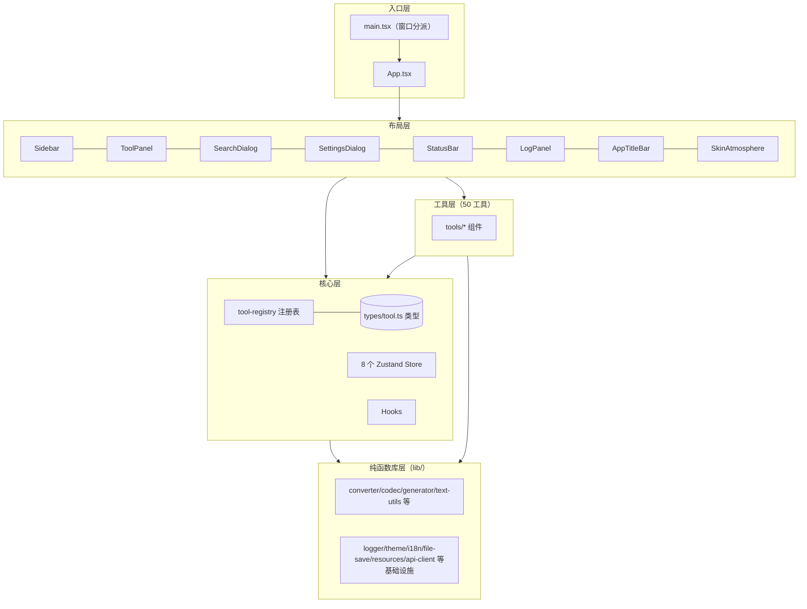

# 09 · 依赖关系

## 1. 前端依赖全景（按用途分组，[package.json](../../package.json)）

### 1.1 框架与基础设施

| 依赖 | 用途 |
| --- | --- |
| react / react-dom 19 | UI 框架（StrictMode） |
| zustand 5 | 8 个 Store（persist/localStorage） |
| i18next + react-i18next + i18next-browser-languagedetector | 中英双语 |
| @tauri-apps/api + plugin-http / plugin-process / plugin-updater | Tauri IPC、绕 CORS 的 fetch、重启、自动更新 |
| class-variance-authority + clsx + tailwind-merge | shadcn 风格 UI 原语（`cn()`） |
| lucide-react | 图标库 |
| sonner | Toast 通知 |
| dayjs | 时间处理（utc/relativeTime 插件） |

### 1.2 编辑器与渲染

| 依赖 | 用途 |
| --- | --- |
| monaco-editor + @monaco-editor/react | 代码/差异/结构化编辑器（monaco-setup 本地化 + 12 皮肤主题） |
| markdown-it + markdown-it-task-list + highlight.js | Markdown 渲染（14 种 hljs 语言按需注册） |
| mermaid + @mermaid-js/mermaid-zenuml | Mermaid 图表（ZenUML 外部图全局注册一次） |
| @excalidraw/excalidraw 0.18 / @tldraw/tldraw 5 + @tldraw/assets | 两块白板（tldraw 资产本地伺服） |
| simple-mind-map | 思维导图（Export/Search/KeyboardNavigation 插件） |
| tesseract.js 7 | OCR（wasm 本地资源化） |

### 1.3 图像 / PDF / 画布

| 依赖 | 用途 |
| --- | --- |
| konva + react-konva | 截图标注编辑器 / GIF 编辑器画布 |
| gifuct-js（解码）+ gifenc（编码） | GIF 双向处理（image-studio 合并 GIF + 录屏 GIF 编辑器） |
| pdf-lib（结构）+ pdfjs-dist v6（渲染） | PDF 工具箱双库分工 |
| qrcode | 二维码生成与识别 |

### 1.4 数据与文本处理

| 依赖 | 用途 |
| --- | --- |
| js-yaml / fast-xml-parser | JSON↔YAML、XML↔JSON、XML 格式化、XMind 导入 |
| jszip | 思维导图 .xmind 解包、多文件打包导出 |
| sql-formatter | SQL 格式化 |
| diff | 文本对比（辅助场景） |
| uuid + ulid + nanoid | ID 生成（nanoid 同时用于注解 id、资源临时文件名） |
| js-md5 | MD5 哈希、百度翻译签名 |
| pinyin-pro | 工具搜索拼音/首字母语料 |
| gifenc/giftuct-js 之外的图像依赖 | 均走原生 canvas/WebCodecs 风格 API（GZip 用原生 CompressionStream，哈希用 WebCrypto） |

### 1.5 开发依赖

Vite 6、TypeScript 5.8、Tailwind 3.4 + @tailwindcss/typography、ESLint 9（扁平配置）+ react-hooks/react-refresh 插件、Vitest 4 + Testing Library + jsdom、Playwright + playwright-core、Husky + lint-staged、@tauri-apps/cli。

## 2. Rust 依赖全景（[Cargo.toml](../../src-tauri/Cargo.toml)）

| 类别 | crate | 用途 |
| --- | --- | --- |
| 框架 | tauri 2（features: tray-icon / image-png / protocol-asset） | 桌面框架 + asset 协议 |
| Tauri 插件 | autostart / dialog / opener / http / global-shortcut / single-instance / updater / process | 开机自启、对话框、HTTP fetch、全局热键、单实例、更新 |
| 异步/网络 | tokio(full) / tokio-tungstenite 0.24 / futures-util / reqwest 0.12（blocking + rustls-tls） | WS 服务端、资源下载 |
| 捕获/图像 | xcap 0.0.14 / image 0.25 / base64 0.22 / arboard 3.4 | 屏幕/窗口枚举捕获、图像编码、剪贴板 |
| 系统工具 | sysinfo 0.35 / sha2 0.10 / nanoid 0.4 / rfd 0.15 / zip 2(deflate) | 系统监控、资源校验、原生对话框、资源解压 |
| Windows FFI | windows 0.58（Win32_Graphics_Dwm/Gdi、NetworkManagement_IpHelper、Networking_WinSock、System_RestartManager/Threading、UI_HiDpi/Input_KeyboardAndMouse/WindowsAndMessaging） | DWM 窗口样式、GDI 截屏、端口表、文件占用、进程终止、滚轮注入、光标 |

## 3. 前端内部分层依赖图

**关键依赖规则**（阅读代码时的心智模型）：
1. `lib/` 层是叶子 —— 纯函数 + 少量基础设施，工具与布局都依赖它，它不反向依赖任何组件；
2. `logger.ts` 通过 **sink 注入模式**避免 logger → log-store 的循环依赖；
3. 布局层不直接 import 具体工具 —— 只经注册表的 lazy `component`；
4. 跨工具协作全部经 store（如 screenshot-ocr-store 连接截图窗/编辑器/翻译）或 window 事件，工具之间无直接 import；
5. Tauri API 一律动态 import + `isTauri` 判定，保持浏览器可运行。

## 4. 外部进程依赖（运行时）

| 程序 | 消费方 | 缺失时行为 |
| --- | --- | --- |
| FFmpeg.exe | recorder.rs（录屏/音频枚举/拼接/帧率探测/GIF）、useRecorder | `RESOURCE_REQUIRED:ffmpeg` → 前端 ResourceNotice 提示下载 |
| chrome-headless-shell.exe | chromium.rs（HTML→PDF/PNG） | 同上（chromium）；可自选本机 Edge/Chrome（probe 验证） |
| java.exe + plantuml.jar | plantuml.rs（JVM worker 池） | 同上（java + plantuml） |
| tesseract wasm + traineddata | 前端 tesseract.js（resource:// 协议取数） | 同上（ocr-* 三包） |
| explorer.exe | 录制产物定位 | 系统自带 |

## 5. 依赖健康度观察

- **零后端 HTTP 依赖的纯本地策略**：所有重计算在前端 JS 或 Rust 本地完成；唯一远程 API 是百度翻译（capability 白名单锁死单一端点）。
- **刻意不引入的库**：GZip 用原生 CompressionStream；SHA 用 WebCrypto；仅 MD5 用 js-md5。
- **react-router-dom 在依赖中但未被使用**（无路由表，导航全靠 Zustand）—— 属于可清理项。
- Windows FFI 全部收敛在 `windows 0.58` 一个 crate，跨平台代码用 `cfg!(windows)` 显式分叉（非 Windows 回退 xcap）。
