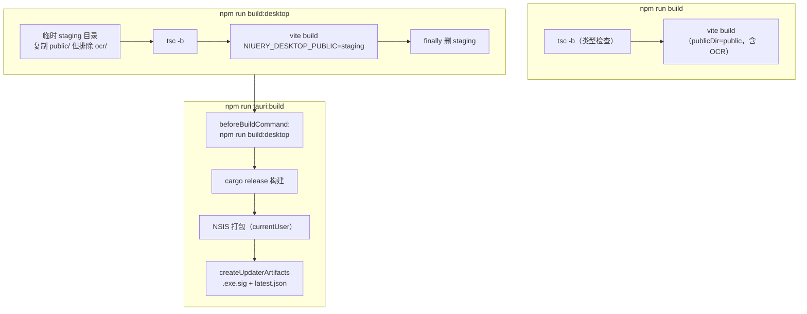

# 10 · 构建运行与测试

## 1. 环境要求

- **Node.js ≥ 18**（CI 用 22）
- **Rust 工具链**（[rustup.rs](https://rustup.rs/)，Tauri 桌面构建必需）
- **Windows**：MSVC 构建工具（Microsoft Visual C++ Build Tools）
- 可选：**Chromium 资源**（仅本地图表/导出 PDF 功能开发时）—— `npm run prepare:chromium`（从 Playwright 浏览器缓存复用 chrome-headless-shell，幂等，`--force` 强制重拷；`NIUERY_SKIP_CHROMIUM=1` 可跳过非必须场景）

## 2. 开发命令

```bash
git clone <repo-url> && cd Niuery-Toolkit
npm install

# 桌面应用开发（完整功能；Rust 端自动 beforeDevCommand 拉起 Vite）
npm run tauri:dev

# 仅前端（浏览器模式，部分桌面功能不可用：isTauri 分叉走 Web 降级路径）
npm run dev
```

**开发端口策略**：Vite 固定 `port: 21516 + strictPort: true + host: true` —— Tauri devUrl 固定端口，被占用直接失败（避免静默换端口导致桌面窗口空白）。

**独立启动自愈**（lib.rs `dev_server` 模块，debug+Windows）：exe 独立运行（如开机自启）时探测 21516 无人监听 → 等 `tauri dev` 10s → 后台 `cmd /C npm run dev`（DETACHED+NO_WINDOW）→ 就绪后主窗 navigate(devUrl)；退出 taskkill 清理。

**开发资源**：`src-tauri/resources/` 保留完整开发用捆绑资源（plantuml/jre、plantuml.jar、ffmpeg.exe + DLL、chromium/win-x64）—— 对应资源解析第 3 优先级（legacy bundled），**不进安装包**（.gitignore 排除二进制）。

## 3. 构建管线



| 命令 | 用途 |
| --- | --- |
| `npm run build` | 纯 Web 构建（保留 `public/ocr`，网页端 OCR 可用） |
| `npm run build:desktop` | 桌面前端构建（**排除 public/ocr**，OCR 资产按需下载）；实现于 [scripts/desktop-build.mjs](../../scripts/desktop-build.mjs) |
| `npm run tauri:build` | 完整桌面打包：NSIS + 更新器签名产物 |
| `npm run resources:pack` | 维护者：生成 7 个资源包 zip + resource-catalog.json（见 08 章 §10） |
| `npm run prepare:chromium` | 开发环境 Chromium 准备（见 §1） |

**Vite 配置要点**（[vite.config.ts](../../vite.config.ts)）：
- 多入口 `rollupOptions.input: {main: index.html, stickyNote: sticky-note.html}`；
- `manualChunks`：`monaco`（monaco + @monaco-editor/react）与 `vendor`（react 系 + zustand）固定 chunk；
- `base: './'`（相对路径，适配 Tauri 自定义协议）；
- `define.__APP_VERSION__` 注入 package.json 版本；
- 自定义插件 `tldrawLocalAssets()`：dev 期 middleware 伺服 `/tldraw-assets/`（node_modules/@tldraw/assets），build 期 emitFile 打进产物 —— 避免把上游资产拷进 public；
- `test` 字段内嵌 Vitest 配置（globals + jsdom + setupFiles + exclude e2e/scripts）。

**tauri.conf.json 要点**：`frontendDist: "../dist"`、`devUrl: http://localhost:21516`、`bundle.targets: ["nsis"]`、`createUpdaterArtifacts: true`、`bundle.resources` 仅 3 个许可证文件、主窗 `decorations: false`、assetProtocol scope 限 `$CACHE/$APPDATA/$APPCACHE/$VIDEO/$HOME`。

## 4. 测试体系（四层）

| 层 | 运行器 | 命令 | 范围 |
| --- | --- | --- | --- |
| 前端单元/组件 | Vitest 4（jsdom + Testing Library） | `npm run test` / `test:watch` | `src/test/` 集中 ~95 个文件 |
| 构建/CI 脚本 | node:test | `npm run test:scripts` | scripts/ 下 5 个 `.test.mjs` |
| Rust 单元/集成 | cargo test | `cargo test`（src-tauri/） | 各模块 `#[cfg(test)]`（中文测试名）+ tests/ 6 个集成文件 |
| E2E | Playwright | `npm run test:e2e` / `:ui` | e2e/ 8 个 spec |

### 4.1 前端单元测试

- 配置内嵌 vite.config.ts；[src/test/setup.ts](../../src/test/setup.ts) 引入 jest-dom + matchMedia stub；
- 测试集中平铺于 `src/test/`（非 colocation）；覆盖：主题/皮肤、store、注册表、OCR 前后处理、Markdown 工具链、截图/录屏 reducer、吉祥物、便签、资源管理等；
- jsdom 下 `isTauri=false` 天然走浏览器路径。

### 4.2 脚本测试（node:test）

- desktop-build（OCR 排除）、resource-packages（可重现 sha256/拒绝逃逸/许可证）、release-notes（CHANGELOG 提取边界）；
- **release-updater / repair-updater**：用 js-yaml 加载**真实的 release.yml 工作流 YAML**，提取内嵌脚本，`new AsyncFunction` 注入 mock github/context/process 执行 —— **工作流本身是被测代码**，验证门禁的各种失败场景全部拒绝发布。

### 4.3 Rust 测试

模块内单测（lib.rs 关闭行为、recorder.rs 16 个含 EOF/时序/回滚、screenshot.rs 会话机、clipboard.rs 去重、capture_guard.rs 决策等）+ 集成测试：
- `recorder_logic.rs`：FFmpeg 参数构建、进度解析、VFR 调度、随附 FFmpeg 视频管道 EOF 行为、concat 无间隙；
- `plantuml_renderer.rs`：bundled 路径、命令参数（`\\?\` 前缀剥离）、JVM 复用、dark 主题、超时；
- `resource_manager.rs`：safe_relative 拒绝穿越/保留名、junction 拒绝、损坏包保留旧安装、白名单外 DLL 拒绝、`#[ignore]` 的真实包全链路验证；
- `asset_protocol_config.rs` / `http_scope_config.rs`：配置守卫（asset scope 必含 $APPCACHE、CSP 必含 blob:、http 白名单必含百度端点）；
- `process_tools.rs`：端口校验、PID 复用防护、保护进程判定。

### 4.4 E2E（Playwright 驱动浏览器模式前端）

**不启动 Tauri 桌面本体**，而是驱动 Vite dev server（端口 4173）下的浏览器模式前端：

```ts
webServer: {
  command: 'npm run dev -- --port 4173 --strictPort',
  url: 'http://localhost:4173',
  reuseExistingServer: !process.env.CI,
}
```

前端经 `isTauri` 分叉走 Web 降级路径；Tauri 原生路径由 cargo 测试 + `src-tauri/examples/resource_smoke.rs`（显式本地冒烟：安装 OCR 三包后在真实 WebView2 验证 `resource://` 协议；`cargo run --offline --example resource_smoke`，需先 `npm run resources:pack` + 21516 dev server）保障。

测试驱动状态注入：普遍用 `page.addInitScript` 预置 localStorage（`niuery-toolkit-store`、`niuery-toolkit-lang`、markdown 草稿）再冷启动验证恢复行为。

| spec | 内容 |
| --- | --- |
| app.spec.ts | 导航/搜索（拼音）/JSON-YAML/Base64/UUID/TextDiff/系统监控/Esc；**离线安全**（拦截全部非 localhost 请求断言为零） |
| theme.spec.ts | 6 皮肤 × 明暗视觉回归截图（`toHaveScreenshot`） |
| ocr-accuracy.spec.ts | 动态 SVG 文本图 → OCR → **Levenshtein 编辑距离**字符准确率 ≥95% |
| markdown-font-size.spec.ts | 字号同步缩放/三视图/等比/上下限 |
| markdown-mermaid.spec.ts | Mermaid 本地渲染/无效语法错误卡片/深色/viewBox 贴合/导出 |
| markdown-outline.spec.ts | 大纲更新/代码块伪标题排除/跳转 |
| mermaid-editor.spec.ts | 实时编辑器端到端 |
| mind-map-shortcuts.spec.ts | Tab/Enter/Del 键盘交互 |

## 5. CI/CD

### 5.1 release.yml（主发布流水线）

触发 `push tags: v*.*.*`；**仅 windows-latest 单平台矩阵**（Node 22 + npm 缓存）；并发组 `desktop-release`（排队不抢占）。步骤：

1. checkout + Node 22 + `npm ci`；
2. **先测发布逻辑本身**：`node --test scripts/release-notes.test.mjs scripts/release-updater.test.mjs scripts/repair-updater.test.mjs`；
3. **准备发布说明**（github-script）：`buildReleaseNotes({changelog, tagName, generateNotes})` —— 优先精确提取 CHANGELOG.md `## [x.y.z]` 章节（严格 semver 校验、CRLF/BOM 兼容、代码围栏内伪标题不算边界、预发布与正式版分离），兜底 GitHub generateReleaseNotes API；
4. **构建发布**（tauri-apps/tauri-action@v0）：env 注入 `TAURI_SIGNING_PRIVATE_KEY(_PASSWORD)`；`releaseDraft: true`（先草稿）+ `includeUpdaterJson: true`（产出 latest.json）+ releaseBody；
5. **验证门禁并发布**（github-script）：校验 releaseId/tag 一致、必须仍是草稿；三件套（`<name>_<version>_x64-setup.exe` + `.sig` + `latest.json`）uploaded；下载 latest.json 校验版本号/平台条目/URL 与安装包一致（修正草稿期 `untagged-` 地址）/签名与 `.sig` 一致 —— **全部通过才 `updateRelease({draft:false, make_latest:'true'})` 公开发布；任何失败保留草稿**。

### 5.2 repair-updater.yml（更新元数据修复）

手动 `workflow_dispatch`（输入 tag）。场景：已发布 Latest 版本**缺 latest.json**（如 v1.2.1 事故）。步骤：`npm ci` + 跑 repair-updater.test.mjs → prepare（校验稳定版/目标为 Latest/latest.json 已存在则拒绝/下载安装包核对 SHA-256）→ 签名（仅当 `.sig` 缺失：`npx tauri signer sign`，**不能换钥**——须与已装版本内嵌 pubkey 对应）→ upload（从 tauri.conf.json 解码 updater pubkey，**手工解析 Tauri minisign 签名结构**（Ed25519）验签；先传 `.sig` 再传 `latest.json` 最后发布端点保证可恢复）；绝不重建安装包/移动标签。

### 5.3 发布流程手册（[docs/releasing.md](../releasing.md)）

版本五处同步（package.json / package-lock.json / Cargo.toml / Cargo.lock / tauri.conf.json）→ CHANGELOG 归档 → `npm run test:scripts` + `npm run build` → 授权提交推送 tag → CI 自动发布。

## 6. 代码规范与 Git Hooks

- **ESLint 9 扁平配置**（[eslint.config.js](../../eslint.config.js)）：@eslint/js + tseslint recommended + react-hooks recommended + react-refresh（only-export-components warn）；`no-unused-vars` error（`argsIgnorePattern: '^_'`）；
- **pre-commit**（.husky/pre-commit）：`tsc -b`（全量类型检查）+ lint-staged（`src/**/*.{ts,tsx}` → `eslint --fix`）；
- **lint-staged** 与 **husky** 经 `prepare: husky` 安装。

## 7. VS Code 集成（.vscode/）

- `tasks.json`：启动 Vite 开发服务器（后台）→ 构建 Tauri 调试程序 → 准备 Tauri 调试环境（串行依赖三任务）；
- `launch.json`：pwa-chrome 调前端（21516）与 LLDB 调 `src-tauri/target/debug/niuery-toolkit.exe` 两配置。

## 8. 目录级补充说明

- `docs/`：仅 `releasing.md` 被 git 跟踪（.gitignore 规则 `docs/*` + `!docs/releasing.md`），adr/ 与 agents/ 为本地内容；
- `CHANGELOG.md`：中文、最新在前，`[Unreleased]` 日常沉淀 → 发布时归入 `[版本] - 日期`，分组"新增/改进/修复/升级提示"；是 release.yml 精确提取发布说明的数据源；
- `AGENTS.md`：issue 跟踪（GitHub + gh CLI）、triage 标签（needs-triage/needs-info/ready-for-agent/ready-for-human/wontfix）、领域文档布局约定。
