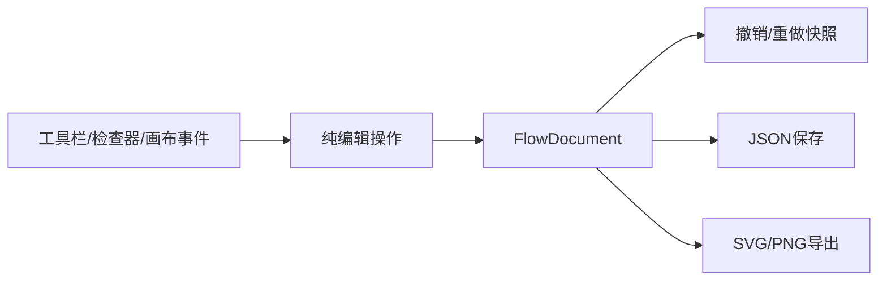

+# React Flow 流程图能力等价设计

日期：2026-10-21

## 目标

在 Niuery Toolkit 的 React Flow 图表编辑器中实现 draw.io 标准流程图的核心编辑能力。目标是用户操作上的等价：能创建常见流程图、连接节点、调整排版、编辑样式、撤销重做、保存和导出。范围不包含完整 draw.io UI、云协作、全量领域图形库或 draw.io 文件兼容。

## 现状

当前编辑器已有五种基础 shape、拖拽/缩放/网格/缩略图、SmoothStep 连线、复制删除、有限撤销重做和 JSON/SVG/PNG 保存导出。对齐、图层按钮尚未接通，节点/边变更并非全部进入历史，且节点模型不能表达标准流程图语义。

## 设计

节点使用稳定的 `semanticType`，渲染 shape 只是视觉实现：

- `terminator`: 开始/结束
- `process`: 处理
- `decision`: 判断
- `io`: 输入/输出
- `document`: 文档
- `database`: 数据库
- `predefined`: 预定义流程
- `connector`: 连接符
- `note`: 注释

旧 `rectangle/rounded/circle/diamond/text` 文件通过迁移函数映射到上述类型，保留 `originalType` 以便未知节点不丢信息。

边保存 `routing`、起始/结束标记、虚线和标签。React Flow 的 `type` 只作为运行时渲染选择，业务字段用于保存和导出。

所有排版和结构操作都通过纯函数接收节点/边并返回新值，页面层统一用文档快照记录历史。这样可以单测规则，也避免 React Flow 的增量 change 事件绕过撤销栈。

## 数据流

## 验收标准

- 新建流程图可直接选择 9 类标准语义节点。
- 选中多个节点后可执行四向对齐和水平/垂直分布。
- 可修改边标签、路由、虚线和起止箭头，并保存到 JSON。
- 删除节点会删除所有关联边。
- 节点拖动、添加、删除、复制、边连接和属性编辑都可撤销/重做。
- 旧 schema v1 JSON 不报错，打开后得到新语义字段。
- SVG/PNG 导出保留新节点基本形状、文本、标签和箭头。
