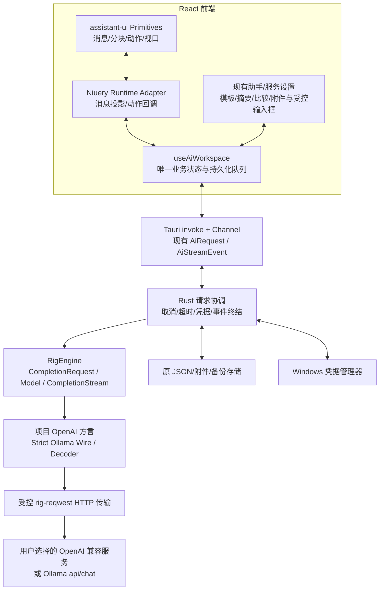

# AI 助手 assistant-ui + Rig 联合迁移方案

> 核验日期：2026-10-20。状态：已实施，具体通过项、调整及限制见 [实施验证报告](AI_FRAMEWORK_MIGRATION_VALIDATION.md)。下文保留原始方案与验收要求，不将未执行的矩阵项标为通过。

## 1. 目标与选择

将 AI 助手的聊天展示与交互建立在 assistant-ui 上，将模型请求和流协议建立在 Rig 上。保留已有业务状态、Tauri IPC、本地数据和 Windows 凭据边界，完成联合迁移后让两套框架成为默认生产路径。

推荐方案：**assistant-ui ExternalStoreRuntime + 自定义外观组件；Rig Core Completion/Wire + 项目适配器**。

其他路线不采用：

| 路线 | 代价与判断 |
|---|---|
| assistant-ui LocalRuntime 自管历史，同时 Rig Agent 自管对话 | 会引入与 AiWorkspace 并列的历史/运行状态，现有版本、分叉、摘要、退出保存需重写 |
| 同时使用 assistant-ui、AI SDK、Rig 三套运行时 | 重叠的流处理与模型抽象增多；本次不引入 AI SDK |
| 推荐：ExternalStoreRuntime 和 Rig Completion 共同适配现有契约 | 保留已验证业务行为，迁移范围清楚；代价是需要少量业务和协议兼容适配 |

本次成功标准不是“依赖列表出现两个包”：消息列表、内容分块、消息动作必须实际由 assistant-ui Runtime/Primitives 驱动；默认模型生成必须经过 Rig Model/CompletionStream，不能在 Rig 外继续运行整套旧生成器。

## 2. 已核实版本与实际风险

### 2.1 准入候选

| 项目 | 已核实值 | 实施决定 |
|---|---|---|
| @assistant-ui/react | npm 发布版 0.15.30；MIT；React/React DOM peer 为 ^18 或 ^19 | 候选精确固定 0.15.30，适配当前 React 19；提交安装后的 package-lock |
| assistant-ui 内部 Core | react 包依赖 @assistant-ui/core ^0.3.30 | 只从 @assistant-ui/react 的公开出口导入；测试锁文件实际解析版本，不直接引用 internal 源码 |
| rig-core | crates.io 发布版 0.45.0；MIT；lib 名称 rig_core；edition 2024 | 依赖精确固定 =0.45.0，使用当前 API；不套用旧版 rig::agent()/RawStreamingChoice 教程 |
| rig-reqwest | 0.45.0；其 reqwest 为 0.13 | 单独连接 Rig 的 HTTP 传输，不把项目的 reqwest 0.12 Client 直接传入 |
| Rust | Rig 最低 1.97.1；本机 rustc 恰为 1.97.1 | 在 Windows CI/打包环境也验证最低版本；候选 rust-toolchain.toml 固定 1.97.1，验证整个 Tauri 工作区后采用 |
| 项目 | React 19、TS 5.8、Tauri 2、Tokio；当前 App crate edition 2021 | 不因依赖 edition 2024 强制改全项目 edition；依赖树和完整编译为准 |

源码核验已完成；依赖解析、TypeScript 编译、Cargo feature 闭包和 Windows 打包尚未进行。候选版本通过第 0 阶段后才作为实施锁定版本。无法通过时必须记录具体失败并调整版本，不能声称当前方案已集成验证。

### 2.2 必须主动处理的差异

1. **Ollama 路由**：Rig 0.45 的 `Ollama::completion()` 走兼容接口；现有应用走原生 `/api/chat`，必须选 `native_completion()`，包括 `options.num_predict`、`message.thinking`、NDJSON、`api/tags` 行为。
2. **OpenAI 路由**：明确使用 `.chat(model)`；不使用可能按模型选择 Responses 的默认 completion 路由，不能把用户的自定义接口前缀换成 `/responses`。
3. **Ollama think 标签**：Rig 的 native decoder 默认将开头 `<think>` 正文拆为 reasoning；项目当前只承认独立思考字段。需项目 StrictOllamaDecoder 保留此规则，不能悄悄改变展示语义。
4. **重定向与重试**：不使用 Rig 默认共享 HTTP Client；由项目显式构造禁重定向的 Client，并实测没有自动重试。失败后不自动换引擎再次提交，避免双重计费。
5. **流终止**：项目允许仅 `[DONE]` 的兼容流完成；Rig 默认方言可能要求 finish_reason。项目方言必须明确恢复此兼容策略，同时没有 `[DONE]` 且无合法结束信号的断流仍失败。
6. **usage 与参数**：Rig 方言默认可能请求 stream usage，并按模型名推断参数；项目已有每模型开关。保留 `streamUsage`、`outputTokenParameter`、`supportsTemperature` 的显式优先级。
7. **思考重放**：Rig 消息结构可能含 reasoning/raw/replay 信息；每次从项目白名单消息重新构造请求，不拿上次 CompletionResponse 直接作为下一轮历史。
8. **凭据**：OpenAIConfig 支持显式 key，但某些构造路径会带 Authorization；无密钥服务必须经项目方言使用无鉴权策略，验证请求中不存在空 Bearer 或假密钥。
9. **超时/限流**：保留首字节 60 秒、流字节空闲 120 秒、流单事件 16 MiB 限制及正文错误保留；不能只在 React 显示超时而让后端继续生成。

## 3. 联合架构与职责



| 职责 | 所有者 | 本次变化 |
|---|---|---|
| 真实会话、消息、任务、版本、草稿 | AiWorkspace / useAiWorkspace | 保留；抽取可复用业务动作，避免 UI 双写 |
| 消息视口、内容分块、动作状态、可访问性 | assistant-ui | 新增 Runtime Adapter 与项目主题组件 |
| 思考显示开关与折叠规则 | 项目组件 + reasoning part | 保留自动展开/完成收起/手动折叠优先规则 |
| 输入框与附件选择 | 项目受控 Composer | 本轮保留受控值，避免 Runtime composer 与草稿镜像相互覆盖 |
| 网络协议、模型基础消息结构 | Rig Core | 采用 CompletionRequest/Model/CompletionStream |
| 目标地址/凭据/取消/超时/IPC | Rust Host + Rig transport adapter | 保留项目控制，框架接入其后 |
| 会话/附件/草稿/导入导出 | 现有存储与业务代码 | 不换数据库、不写入框架对象 |
| PDF 提取 | 现有本地 PDF.js | 不改为 Rig PDF loader，不引入新下载资源 |

这里的“唯一状态”指业务数据只写 AiWorkspace；assistant-ui 的运行时索引、展开状态和焦点是派生/临时 UI 状态，不另存一份可写历史。

## 4. 前端具体接入

### 4.1 文件分工

| 文件 | 操作/职责 |
|---|---|
| `src/tools/ai-assistant/runtime/message-mapper.ts` | 新增：AiMessage → ThreadMessageLike，纯投影 |
| `src/tools/ai-assistant/runtime/use-niuery-runtime.ts` | 新增：ExternalStoreRuntime，绑定普通聊天动作 |
| `src/tools/ai-assistant/runtime/ai-actions.ts` | 新增：统一发送/跨目标确认/重试/编辑入口，供既有输入框和框架动作共享 |
| `src/tools/ai-assistant/runtime/thread-view.tsx` | 新增：ThreadPrimitive Root/Viewport/Messages，替换手写 map 和自动滚动 |
| `src/tools/ai-assistant/runtime/message-parts.tsx` | 新增：Text/Reasoning/File 等内容渲染，保留 HTML/远程图限制 |
| `src/tools/ai-assistant/runtime/task-runtime.tsx` | 新增：每个摘要/对比结果只读 runtime，不把任务结果塞进聊天历史 |
| `src/tools/ai-assistant/index.tsx` | 消息区接新 runtime；侧栏、设置、模板、参数与受控输入继续复用 |
| `src/tools/ai-assistant/task-results.tsx` | 使用只读 task runtime 和同一消息组件 |
| `src/tools/ai-assistant/use-ai-workspace.ts` | 提供明确发送选项；保留持久化/停止锁/退出握手 |
| `src/tools/ai-assistant/message-view.tsx` | 迁移为框架 Message Root/Parts 及动作组合；迁移结束删除重复手写列表/动作运行逻辑 |
| `src/tools/ai-assistant/ai-assistant.css` | 用项目主题变量设置 primitive class，不引入另一套全局 reset |

### 4.2 消息映射

- message ID 原样使用，不重新 nanoid；createdAt 转 Date；user 消息不设置 assistant status。
- `thinking` → `{ type: 'reasoning', text }`，先于 `{ type: 'text', text: content }`。
- showThinking=false 时只在投影中隐藏 reasoning part，数据和导出保留。
- user 附件映射到 attachments，不能同时在 content 和 attachments 重复展示。文本/PDF 保留自定义预览和原附件 ID；图片使用本地受控 data/blob，不开放模型正文远程图片自动加载。
- metadata.custom 仅放安全引用和显示数据：conversationId/messageId、模型标签、用量、计时、版本索引；不得把完整 AiWorkspace、密钥或原始请求塞进去。
- 版本仍由 `versions/selectedVersion` 管理；UI 版本选择调用现有领域方法。当前“分叉为新会话”也保留，不同时启用框架的独立分支仓库。

状态映射表：

| 项目状态 | assistant-ui status | 项目额外显示 |
|---|---|---|
| waiting / streaming | running | waiting 显示等待；thinking 到达显示思考；正文到达显示生成 |
| complete + stop/未提供结束原因 | complete / stop 或 unknown | 显示实际用量和耗时 |
| complete + length | incomplete / length | 不删答案，提示达到上限 |
| complete + content_filter | incomplete / content-filter | 保留已到达部分，显示过滤原因 |
| stopped | incomplete / cancelled | 显示已停止 |
| failed | incomplete / error | 保留部分内容和安全错误 |
| interrupted | incomplete / other | 显示意外中断，禁自动恢复网络 |

映射不会反向修改持久化 status。`isRunning` 由真实 busy/request 状态提供，不能只看最后一条消息；比较任务期间也不能让 Send 误解锁。

### 4.3 Runtime 接口示例

下列为候选版公开类型对应的骨架，实施后需由真实类型编译与交互测试验收：

```ts
import {
  useExternalStoreRuntime,
  type AppendMessage,
  type ThreadMessageLike,
} from '@assistant-ui/react';

type NiueryActions = {
  append(message: AppendMessage): Promise<void>;
  edit(message: AppendMessage): Promise<void>;
  reload(parentId: string | null): Promise<void>;
  cancel(): Promise<void>;
};

type NiueryRuntimeInput<T> = {
  messages: readonly T[];
  convertMessage(message: T, index: number): ThreadMessageLike;
  isLoading: boolean;
  isDisabled: boolean;
  isSendDisabled: boolean;
  isRunning: boolean;
  activeRunId?: string;
  actions: NiueryActions;
};

export function useNiueryRuntime<T>(input: NiueryRuntimeInput<T>) {
  return useExternalStoreRuntime<T>({
    messages: input.messages,
    convertMessage: input.convertMessage,
    isLoading: input.isLoading,
    isDisabled: input.isDisabled,
    isSendDisabled: input.isSendDisabled,
    isRunning: input.isRunning,
    activeRunId: input.activeRunId,
    onNew: input.actions.append,
    onEdit: input.actions.edit,
    onReload: parentId => input.actions.reload(parentId),
    onCancel: input.actions.cancel,
  });
}
```

会话 Runtime 根节点以 `key={conversation.id}` 隔离内存索引和临时 composer 状态；切换会话不触发后台请求。真正生成状态仍在根工作区保存，切到其他会话不错误地显示当前正在生成。

### 4.4 输入、确认、编辑的特殊处理

1. 本次继续使用现有受控 textarea 和附件管理，AiConversation.draft/draftAttachments 是唯一可编辑来源；不要顺手挂上独立的 ComposerPrimitive.Input。
2. append 接到不可变发送快照，包括 conversationId、draft、attachment IDs、目标地址。先校验模型/上下文，再取得跨服务同意，再持久化，然后开始网络。
3. 取消确认时不清空草稿、不增加用户消息、不调用生成；过了确认再校验目标仍相同，地址变化则失效。
4. `onReload(parentId)` 只允许当前支持的最后一条回复；从老回复操作时提供“分叉后生成”，禁止忽略 parentId 直接重试错误问题。
5. `onEdit` 复用“替换后续记录/分叉后编辑”确认，不能由框架自行改写消息树。
6. 生成中下一条草稿允许编辑，Send 被禁用；停止必须等 Rust 取消完成后解锁。退出/更新期间全部 mutation 保持原有锁。
7. 框架消息列表接管滚动；搜索定位通过 message ID 的 DOM 标记执行。移除旧滚动 effect 的时机是新视口阅读保持测试通过之后，避免两个滚动控制器争抢。

受控输入框的 Send 最终只调用一次 `runtime.thread.append(...)`，再由 onNew 调用统一 actions.append；不可同时再调用 api.send。发送前先把正文/附件映射为 AppendMessage，actions.append 立即从其内容和附件 ID 建立快照，清空草稿只能发生在原持久化发送提交点。`AiSendOptions` 增加可选 `attachments?: AiAttachment[]` 用于快照发送，既有调用不传时仍取 chat.draftAttachments；其 ID/MIME/data 继续经现有验证。引用和模板直接更新 store.draft，不借用框架内部 composer。

当前 `api.send` 捕获错误并暴露 error 状态，不能把 Promise resolve 当作“已提交”。第 1 阶段为动作层引入 `AiSendOutcome = { type:'not-sent'; reason:string } | { type:'settled'; requestId:string }`：not-sent 表示没有建立网络请求且没有可恢复的消息提交（如取消确认、预算失败），让 runtime onNew 使用候选公开 `MessageNotSentError` 通知未发送；已保存的消息若网络失败，则保留失败消息并返回 settled，不能错误恢复草稿造成重复发送。最终根据真实依赖编译确认导出位置；项目受控 composer 的草稿恢复仍以 store 为准，不启用框架内置第二份草稿。

只读任务 runtime 明确设置 isDisabled=true、不挂 Composer/编辑/重试入口；isRunning 由 busy.messageId 是否匹配结果消息计算，尚未执行的结果显示排队而不是误标实际生成。取消入口统一保留在工作区，不允许多份 runtime 各自取消同一请求。

如以后确实需要框架 Composer，可以单独做草稿和附件适配迁移；不作为本次完成的隐含条件。

## 5. 后端 Rig 接入

### 5.1 边界和文件

```text
src-tauri/src/ai_assistant/
  mod.rs                 保留 Tauri commands、Active slot、退出和取消协调
  types.rs               保留项目 IPC/存储 DTO
  credentials.rs         保留
  storage.rs             保留
  validation.rs          从旧 protocol 提取地址/模型/附件校验
  engine/mod.rs          模型引擎统一入口、ProviderContext
  engine/request.rs      AiRequest → Rig CompletionRequest
  engine/rig_engine.rs   Model / CompletionStream 驱动
  engine/events.rs       Rig part/event/usage/finish → AiStreamEvent
  engine/transport.rs    禁重定向、无自动重试、字节活动与大小限制
  engine/openai_compat.rs 项目方言、输出参数、无 key、结束标记兼容
  engine/ollama_wire.rs  复用 native wire 编码并选择 StrictOllamaDecoder
  engine/ollama_decoder.rs 仅独立 thinking 字段，忽略正文 think 标签
  engine/legacy.rs       迁移期旧生成实现；最终删除
```

`AiBackend.generate`、`ai_generate`、`ai_cancel`、requestId/conversationId/messageId 和既有事件名保持不变。前端不直接依赖 Rig 的 Rust 类型。

### 5.2 依赖候选

```toml
# Cargo.toml: Rig transport 的 reqwest 由 rig-reqwest 重导出，防止 Client 版本混用。
rig-core = { version = "=0.45.0", default-features = false }
rig-reqwest = { version = "=0.45.0", default-features = false, features = ["rustls"] }
```

不启用 Rig 的 agent、向量存储、PDF、音频、WebSocket。项目原 reqwest 0.12 仍供其他模块使用；Rig 的 0.13 构建体积增加必须记录，暂不把其他工具统一升级。

项目当前 API Key 由 Rust 读取，直接传入 provider config；禁用 from_env，不生成或修改 `.env`。不序列化带凭据的 Rig Config/Wire，也不记录 Debug 对象。`record_telemetry_content=false`，且不在 trace 层启用请求/响应正文。

### 5.3 两种 provider 的选取

```rust
// 已核实 0.45 公开类型/方法；此片段展示路由选择，不包含后文 transport guards。
use rig_core::providers::{openai::OpenAIConfig, ollama::OllamaConfig};
use rig_reqwest::{ReqwestClient, reqwest};

let client = reqwest::Client::builder()
    .redirect(reqwest::redirect::Policy::none())
    .connect_timeout(std::time::Duration::from_secs(60))
    .build()?;
let http = ReqwestClient::from(client);

let openai = OpenAIConfig::new(explicit_key)
    .with_base_url(validated_base_url)
    .connect(http.clone());
let chat_model = openai.chat(selected_model_id);

let ollama = OllamaConfig::new()
    .with_base_url(validated_ollama_root)
    .connect(http);
let native_model = ollama.native_completion(selected_ollama_model);
```

正式 OpenAI 路径应使用项目显式兼容方言，而非上述演示的默认 OpenAIConfig：

- 按模型配置选择 max_tokens/max_completion_tokens；温度不支持则不发；不能依赖 ID 名称推断覆盖手动设置。
- stream_usage 关闭时没有 stream_options；开启且服务不提供用量时不伪造 0。
- 使用自定义完整前缀，保留 `/custom/v1/chat/completions`；不重复拼接 v1。
- 保留历史 `[DONE]` 完成语义，使用兼容方言 `done_without_finish_reason`；默认运行新严格方言会破坏旧服务。
- 无 key 时使用无鉴权 Auth 配置；不发空 Bearer。
- request.additional_params 由项目白名单生成，禁止覆盖 model、messages、stream、base URL 和鉴权。

Rig 的 Dialect 持有静态配置引用；项目按有限组合选择预定义静态方言（有无鉴权、usage、output cap），或由公开 Wire 包装实现逐请求策略。禁止为每个用户地址/请求 Box::leak 一份方言；真实 URL 和 key 仍作为 Config 实例字段传入。模型名触发的 reasoning replay 字段还须抓包验证，发现重放或空字段自动注入时通过 Wire 编码适配明确去除，不靠提示词约束。

### 5.4 Strict Ollama 解码策略

这是版本准入必须完成的兼容适配，而非自动降级到旧网络生成器：

- `NiueryOllamaWire` 实现 Rig 公开 Wire，delegate 原生 `Chat` 的 describe、encode 和 reassembler，替换 `decoder()` 返回项目 StrictOllamaDecoder。
- decoder 使用公开 Decoder/Out/Block/Finish 写规范化事件，仅对 `message.thinking` 写 reasoning，对 `message.content` 原样写 text。正文 `<think>example</think>` 仍是正文，包括跨片段标签。
- 原生 `done:true` 关闭片段并提供 done_reason、prompt_eval_count、eval_count；没有 done 的 EOF → Truncated。
- 不导入 Rig internal helper。其分类注释要求使用内部 helper，但对外不可依赖；项目用公开 WireFrame/ChatRecord 完成等价 JSON 分类并覆盖畸形 JSON、error、未知 frame，向上游反馈公开可扩展性问题。
- 如果当前版 Wire/Reassembler 的公开约束不能支持这一实现，第 0 阶段判定该版不准入：优先采用公开可构造路径或小型 vendored Rig 补丁，附具体差异和许可证；不能在发布路径悄悄启用标签拆分。需要 vendoring 时重新评估工期与版本选择。

### 5.5 请求投影

- 从清洗后的 requestMessages 重建 Rig 消息，不传 thinking、versions、old response/raw、approvedTargets 或任务数据。
- systemPrompt（含已确认接续摘要）保留为 system；history 已由现有预算裁剪完成，Rig 不再额外自动记忆或摘要。
- 文本附件沿用已验证的文件名/边界格式；PDF 仍发送本机提取后的文本与页码。
- 图片向 Rig 的图片内容结构映射 base64、MIME 和 image detail；Ollama 编码恢复 native images，不重复套 data URL。
- 完整历史对、当前输入、模型图片能力和附件容量都先校验。Rig 自动模型目录/facts 不能悄悄追加上下文或改变用户参数；额外字段只从显式配置建立。

### 5.6 流与取消

Rig 0.45 流是 `CompletionStream` / `Streamed<Completion>`，元素为 `Result<Item<StreamEvent>, ProviderError>`，不再使用旧版 RawStreamingChoice：

| Rig 事件/结果 | 项目事件 | 处理 |
|---|---|---|
| Event Text {text} | delta | 只追加本次增量 |
| Event Reasoning {text} | thinking | 独立追加，不拼到正文 |
| Event Start/End | 内部片段状态 | 维护 part ID；End 含全文，不重复追加已消费正文 |
| Item Unknown | 内部兼容诊断 | 只记录字段/大小；不丢弃紧随其后的已知内容；不执行任何指令 |
| stream.partial / finish response | metadata | 去重读取 usage、finish_reason；缺失不补零 |
| ProviderError / 截断 | error | 已推送的正文和思考保留 |
| 用户取消/退出 | stopped / interrupted | drop 流，等待 active slot 清理完成，忽略后续事件 |

终结事件只由 Rust Host 发一次，engine 不另发 done。带合法 length/content_filter 的结束映射保持现有展示，不把它当网络错误丢弃答案。

取消选择必须包围 `stream.next()` 和请求建立；Rig 流 drop 取消本地读取不保证远端停止计费，沿用应用现有“停止接收”语义。不要在取消时调用 `finish()` 继续把剩余流读取完。

超时与上限在 transport guard 层观察实际字节活动，不能只以正文 delta 为时钟；思考或心跳到达也算活动。用 current deadline 和 Tokio watch 保留请求建立/空闲超时，原单事件上限和部分内容保留的测试移到 guard/engine。

## 6. 数据兼容与回退

### 6.1 无持久化格式迁移

- 保留 workspace version=1、目录布局、原子写/备份/附件回收、凭据命名空间和 export 格式。
- 不保存 ThreadMessageLike、Rig Message、CompletionResponse、raw 或框架序列化的分支树。
- 数据流：原文件 → AiWorkspace → UI projection；发送 → AiRequest → Rig request；响应 → AiStreamEvent → 原字段。
- 工程开始前复制专用脱敏测试数据；真实工作区只做只读校验，桌面验证使用独立应用标识。
- 正常运行时 UI 投影不得触发 save、修改 updatedAt 或导致静默 schema 降级。

### 6.2 迁移开关

迁移期两个独立工程开关，不写入旧 workspace：`AI_UI=legacy|assistant`、`AI_ENGINE=legacy|rig`。通过编译/开发配置注入，正式配置不提供给普通用户。

| UI | Engine | 用途 |
|---|---|---|
| legacy | legacy | 基线 |
| assistant | legacy | 只定位前端适配问题 |
| legacy | rig | 只定位后端协议问题 |
| assistant | rig | 最终交付路径 |

只在无进行中请求时切换；不在异常后对同一请求自动重发到另一引擎。任一阶段失败，保留原文件和测试，返回上一已验证组合。最终联合验收后删除产品内旧生成器与旧消息列表，使两框架成为默认路径；保留验收证据和可恢复的 Git diff/授权后的提交历史，不长期维护两套系统。

## 7. 实施顺序、任务与验收

“同时引入”指同一迁移项目覆盖两框架，不表示一次把两层直接替换。以下顺序可单人串行执行，也可在同一契约固定后并行开发前后端。

### 第 0 阶段：版本准入与兼容性小样，1–2 人日

**文件**：package.json、package-lock.json、src-tauri/Cargo.toml、Cargo.lock、候选 rust-toolchain.toml；`src/test/ai-assistant-runtime-smoke.test.tsx`、`src-tauri/src/ai_assistant/engine/rig_smoke.rs`。

- [ ] 冻结现有未提交改动的只读 diff 与测试基线；不自动提交；保留用户后续改动。
- [ ] 在获准实施后分别安装精确版本，跑 TypeScript 5.8 与 React 19 真实依赖检查；若真实类型需要升级 TS，先记录变更及其他工具编译影响再纳入依赖任务。
- [ ] Rust 最小流模型使用 `.chat()` 和 `.native_completion()` 编译，禁重定向 transport、StrictOllamaWire、完整前缀、空 key、reasoning 和异常 EOF 都有真实本地 HTTP 夹具。
- [ ] assistant-ui 实际渲染两条消息与 reasoning part，更新一次外部状态，取消回调只执行一次；不能只测试 import 成功。
- [ ] 记录 Node 22 CI、Rust 1.97.1、依赖双 reqwest、构建增量体积、许可证和公开 API 使用清单。

**退出标准**：依赖编译、关键兼容性小样全绿；没有靠更改现有思考/路由/密钥语义来“通过”。不满足则调整候选版本后重跑，不进入批量替换。

### 第 1 阶段：契约与业务动作隔离，1–2 人日

**文件**：types.ts、use-ai-workspace.ts、request-messages.ts、runtime/ai-actions.ts、engine/mod.rs、engine/events.rs；现有 workspace/backend/protocol tests。

- [ ] 消息、请求、事件与终结契约固定，增加单次 terminal assertion，暂不改变 IPC 形状。
- [ ] 将跨目标确认从页面内闭包变为可等待动作；发送快照持久化完成前不得联网；取消确认返回未发送结果。
- [ ] 校验保存失败、退出锁、更新锁、取消完成锁、任务顺序与旧事件拒绝。
- [ ] 以 fake backend + 真 useAiWorkspace 测试业务；以本地 HTTP 服务器测试 engine，不读取真实 key。

**行为测试样例**（实施时放入现有 workspace test helper 上下文）：

```ts
it('does not replay thinking or answer versions to either engine', async () => {
  const state = fixture();
  state.conversations[0].messages = [
    { id: 'u', role: 'user', content: 'Q', attachments: [], status: 'complete', createdAt: 1 },
    { id: 'a', role: 'assistant', content: 'A', thinking: 'do not replay',
      attachments: [], status: 'complete', createdAt: 2,
      versions: [{ content: 'older', thinking: 'old private field', status: 'complete', createdAt: 1 }] },
  ];
  const { result, fake, chatId } = await setup(state);
  act(() => { void result.current.send(chatId); });
  await waitFor(() => expect(fake.request).toBeDefined());
  expect(JSON.stringify(fake.request)).not.toContain('do not replay');
  expect(JSON.stringify(fake.request)).not.toContain('old private field');
  act(() => fake.event('done'));
});
```

**退出标准**：两个引擎能复用同一测试输入/预期项目事件；页面旧 UI 仍可正常操作。

### 第 2 阶段：Rig 后端替换，3–5 人日

**文件**：engine/request.rs、rig_engine.rs、transport.rs、openai_compat.rs、ollama_wire.rs、ollama_decoder.rs、mod.rs；新增 engine 测试模块。

- [ ] 先写本地 HTTP 请求捕获测试，再实现标准 Rig request 转换；逐字段对照旧请求，禁止用“有回答即可”替代语义校验。
- [ ] OpenAI 项目方言、Ollama strict decoder；输出参数、usage、无 key 和 think 标签保持既有语义。
- [ ] 普通生成、所选模型测试、模型列表通过统一 provider factory；testConnection 保持仅目录探测的行为。目录别名/能力刷新保留。
- [ ] 完整消费 Rig Text/Reasoning，metadata 从 partial/finish 去重映射；断流/超时/取消保留已显示内容。
- [ ] 对 localhost/远程前缀、重定向、代理、HTTP 错误、UTF-8 分片运行同一行为测试。
- [ ] 切 `legacy UI + rig engine`，普通/摘要/比较请求都实际经过 Rig。

**退出标准**：后端验收矩阵全绿，生成请求最多一次，active slot 等取消完成才释放。

### 第 3 阶段：assistant-ui 前端替换，3–5 人日

**文件**：runtime 下 mapper/runtime/thread/parts/actions/task-runtime；index.tsx、message-view.tsx、task-results.tsx、ai-assistant.css；新增 runtime/messages 测试。

- [ ] 纯 mapper 先测 status、reasoning/text 顺序、附件、时间、missing model；保持稳定 ID。
- [ ] ThreadPrimitive.Root/Viewport/Messages 与 MessagePrimitive.Root/Parts 替换手写列表/内容分块；所有发送/重试/取消入口绑定统一业务动作。
- [ ] 保留项目安全 Markdown、高亮、思考折叠规则、模型元信息、复制正文/引用正文限制、版本和分叉按钮。
- [ ] 每个任务只读 runtime；任务区域不会触发普通聊天历史变更，也不会创建独立网络请求。
- [ ] 侧栏筛选、跨助手命中定位、归档/置顶/删除保留；controlled composer 的 IME、粘贴/拖放、草稿切换、附件读取防串会话都验证。
- [ ] 流式输出跟随底部，用户上滚后保持；思考展开不强制打断阅读；中英文、亮暗、多皮肤、900/1280/1600 宽度验证。
- [ ] 切 `assistant UI + legacy engine` 单独测试，再启联合组合。

**退出标准**：前端验收矩阵全绿；message state 只在 useAiWorkspace 写；没有一个旧 effect 与新 runtime 重复滚动或重复调用 send。

### 第 4 阶段：联合验证与清理，2–3 人日

**文件**：集成 tests/E2E、docs/wiki 验证报告、依赖锁与旧实现删除。

- [ ] `assistant UI + rig engine` 的完整桌面流程：配置 → 聊天 → 思考 → 停止 → 重新生成/换版本 → 分叉 → PDF 问答 → 摘要接续 → 2–4 模型比较 → 重启恢复。
- [ ] 独立 app identifier、本地可控服务、专用数据目录，验证真实 WebView2；浏览器测试不能替代 Tauri 文件/凭据/流通道验证。
- [ ] 对旧数据样本做双向读取、显示/导出比较；normal load/save 不丢草稿、versions、thinking、tasks、approvedTargets、附件。
- [ ] 检查依赖 body logging/云请求，启动时不联网；关闭助手后不得残留生成。
- [ ] 全套测试/构建/包体/耗时/性能测量；记录范围外既有失败，不能用定向通过声称全仓通过。
- [ ] 删除旧 Decoder/请求生成器和重复手写消息列表；保留被其他模块使用的 reqwest、markdown-it/highlight.js 等共享依赖。
- [ ] 更新开发与用户说明；commit/push/release 均须另行用户授权。

**总量估算**：10–17 人日，按现有功能完整保留估算，不是承诺工期。公开 Wire 适配或 TS/MSRV 不兼容时重新估算。验收是完成依据，不能用时间耗尽替代功能完整。

## 8. 验收矩阵

| 分组 | 必测情况 | 证明结果 |
|---|---|---|
| 传输 | prefix、代理、无 key、302、401/403/404/429、失败不自动重试 | 捕获原始本地 HTTP 请求；302 的第二目标没收到 key 或请求 |
| OpenAI | SSE 多行、UTF-8 单字节分片、三类 reasoning、[DONE] 无 finish、异常 EOF | 规范化内容/思考与项目基线一致，终结只一次 |
| Ollama | native api/chat、NDJSON、thinking、正文 think 标签、done/断流 | 正文标签不被拆分，native options/计数保留 |
| 参数 | temperature=false、两类 output cap、streamUsage off、缺失 usage、未知容量 | 抓包字段与配置一致，缺失不伪造 |
| 附件 | 图片 MIME/大小、文本 UTF-8、PDF 页码、损坏/扫描件、历史携图换文本模型 | 本机处理和原安全限制不回退 |
| 取消与恢复 | 请求建立前/首字前/正文中/思考中/比较第 1–4 项、退出/更新/reset | 等后台释放锁；已到达内容和草稿保留，无下一次请求偷跑 |
| 消息 UI | 首次思考展开、手动折叠、完成/失败折叠、版本切换、无思考隐藏 | 可见状态、键盘操作、aria 状态与当前一致 |
| 业务 | 搜索定位、置顶归档、模板变量、引用、编辑确认、分叉/版本、摘要/比较 | 只写原业务 store，不出现双重用户消息/对话丢失 |
| 数据 | 旧 version=1、部分中断、备份损坏、保存失败、附件回收 | 数据校验/备份行为一致，不覆盖无法恢复的数据 |
| 性能 | 1000 消息、200 KB 文本、多图、密集增量、4 模型结果 | 与基线同机同数据测量，输入/上滚不卡死，内存和包体有明确记录 |
| 运行环境 | Windows WebView2、Node22 CI、Rust 1.97.1、离线启动、无 key 预览 | 编译/运行证据完整，禁止云服务依赖成为隐式前置 |

性能建议门槛：同机冷启动/消息首帧不比基线增加超过 20%，1000 条消息本地搜索响应 P95 ≤200 ms，流式期间输入响应 P95 ≤100 ms；这些是待实测的项目验收目标，不是框架性能承诺。包体增量先记录来源再评估，不凭“Rust 框架”推断更轻。

## 9. 验证命令与完成定义

```powershell
$aiTests = @(Get-ChildItem src/test -Filter 'ai-assistant*.test*' | ForEach-Object { $_.FullName })
npm test -- --maxWorkers=2 $aiTests
npm test -- --maxWorkers=2
npx tsc -b
npx eslint src/tools/ai-assistant src/test/ai-assistant*.test*
cargo test --manifest-path src-tauri/Cargo.toml ai_assistant --lib
rustfmt --check --edition 2021 src-tauri/src/ai_assistant/mod.rs src-tauri/src/ai_assistant/types.rs
npm run build
git diff --check
```

新增 Rust engine 文件也加入 rustfmt 检查。新增 E2E 以真实仓库的 Playwright 配置执行；Windows 桌面另外做独立标识 Tauri debug/CDP 验证，不能只截图 Chrome。

全仓 lint 另运行 `npm run lint` 并记录全部结果；若扫描到已有 Rust 构建产物或范围外规则错误，明确列为基线问题，不为制造“全绿”而删除断言或修改其他工具。

本次只重新跑了现有 AI 基线：15 文件、135 项通过（`output/ai-framework-research/current-ai-baseline.log`）。此前会话中的 849/26 等数字不作为未来迁移的验证结果。

最终完成须同时满足：

1. assistant-ui 和 Rig 均为默认实际执行路径，两个独立验收和联合验收通过。
2. 矩阵中的每项有具体测试/请求日志/桌面操作证据，已知失败明确分类。
3. 原格式与凭据兼容，所有当前功能可操作，未被“框架自带”替换成缺失功能。
4. 旧生产生成器和重复消息控制器已清理，无错误自动双发。
5. 用户能在新 UI 中继续旧会话，并看到 thinking、versions、tasks 和附件。

### 9.1 方案自检（本次已完成）

- [x] 前端和后端都进入最终默认路径，没有把用户目标缩减为只试一个框架。
- [x] 已检查公开 adapter、Rig Stream/Completion、Ollama native 路由、reqwest 0.13 与 Rust 最低版本；源码证据可追溯。
- [x] 旧数据和业务不做隐式替换；取消确认、未发送结果、草稿权威来源、任务只读 runtime 和发送去重有明确处理。
- [x] 版本准入、协议兼容、联合测试与清理旧实现都有退出标准；未把源码检查声称为集成已通过。
- [x] 实施文件、阶段依赖、工期估算、回退组合和测试命令已明确；计划内无未解释的占位项。

## 10. 官方依据与核验边界

文档与 API 事实来自官方 registry 和发布源码，下载只放在 output/，没有向项目安装依赖：

- assistant-ui ExternalStoreRuntime 文档：https://www.assistant-ui.com/docs/runtimes/custom/external-store
- npm manifest：https://registry.npmjs.org/@assistant-ui/react/latest （核验返回 0.15.30）
- assistant-ui 发布源：https://registry.npmjs.org/@assistant-ui/react/-/react-0.15.30.tgz
- Core 发布源：https://registry.npmjs.org/@assistant-ui/core/-/core-0.3.30.tgz
- Rig metadata：https://crates.io/api/v1/crates/rig-core （核验 stable 0.45.0）
- Rig 发布源：https://crates.io/api/v1/crates/rig-core/0.45.0/download
- Rig HTTP 发布源：https://crates.io/api/v1/crates/rig-reqwest/0.45.0/download
- 官方仓库：https://github.com/assistant-ui/assistant-ui 、https://github.com/0xPlaygrounds/rig

准确源码位置与校验摘要见 `output/ai-framework-research/verification-manifest.json`；包括 ExternalStoreAdapter、ThreadMessageLike、Rig streaming/event.rs、Ollama client/decoder、rig-reqwest。在线 web 工具本次未返回可用结果，因此没有用搜索摘要作为依据，使用 shell 只读下载官方发布文件并核对内容。

这些核验足以制定实施路线，但不等价于已验证框架能无损替代现有实现；第 0 阶段的真实编译和协议小样是强制准入门槛。
